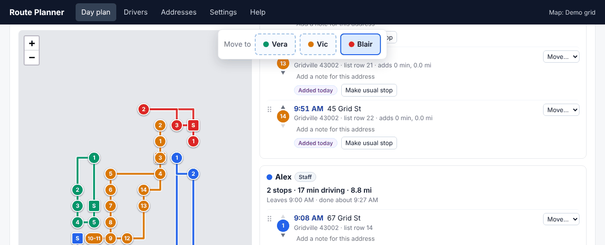
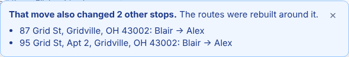

# 5. Adjust the routes

The routes the app builds are a starting point. You can move stops between drivers, change the order, add notes, and turn an extra stop into a usual one.

## Move a stop to another driver

There are two ways.

**Drag it.** Pick the stop up by the handle (⠿) at its left edge and drop it on the other driver's list. While you are dragging, a bar appears at the top of the window with the name of each driver who can take the stop. Dropping the stop on a name does the same thing, which is quicker when that driver's list is further down the page.

**Use the menu.** Open **Move…** at the right of the stop and choose **To** and the driver's name.

Either way:

- The move is for today only. The stop is labeled **Moved here by you**.
- To undo it, open **Move…** on that stop and choose **Back to automatic**.
- A move onto a volunteer is kept even if it takes them over a limit. Their list then shows a red **Over limit** line.

### Other stops may move too

Moving one stop rebuilds the day around it, so other stops can change driver as a result. For example, if staff share stops evenly and you give one driver an extra stop, another of their stops may pass to someone else.

When that happens, a message lists every other stop that changed driver. If no message appears, nothing else moved.

### Locked volunteers

Nothing can be added to a locked volunteer's stops and none of their usual stops can be moved away. They are not offered in the bar or the menu. Turn the lock off on the [Drivers](../reference/drivers.md#lock) page first.

## Change the order of a route

**Drag** a stop by its handle to a new place in the same list, or use the **▲** and **▼** arrows beside its stop number to move it one place.

The route is then marked **Arranged by hand**, and:

- arrival times, driving time and distance are worked out again for the new order
- the order is kept when routes are rebuilt, with any stop added later placed at the end
- **Back to automatic order** returns the route to the order the app would choose

Changing the order of one route does not change who has which stop.

## Notes

Type in **Add a note for this address** under a stop and press Enter. Use it for things a driver needs at the door: a gate code, "side door", "call first".

A note belongs to the address, not to the day. It comes back every time that address is on a list, prints on the driver sheet, and is included in the CSV. You can also edit notes on the [Addresses](../reference/addresses.md) page.

## Make an extra stop a usual stop

A stop labeled **Added today** or **Moved here by you** on a volunteer's list is theirs for today only. To make it one of their usual stops from now on:

- press **Make usual stop** on that stop, or
- press **Make all added stops usual** at the top of the volunteer's list.

A line then offers **Undo**, which puts both the usual stops and the day's routes back as they were. Undo goes back one step.

Stops that a driver is covering for a volunteer who is off cannot be made usual this way. Change their usual volunteer on the [Addresses](../reference/addresses.md) page instead.

Next: [export](export.md).
