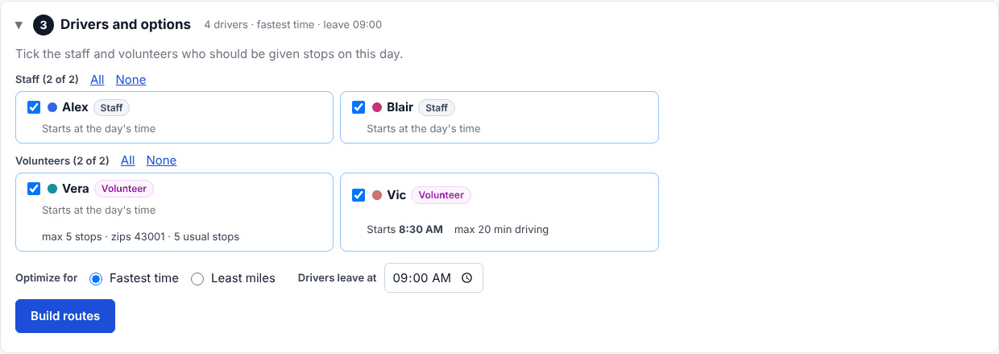

# 3. Selecting drivers and options

Under **Drivers and options** you say who is working today and what the routes should aim for.

## Working drivers

Tick each staff driver and volunteer who should be given stops today. **All** and **None** tick or untick a whole group.

Each driver's box is a reminder of their settings: staff or volunteer, a lock, their own start time, and a volunteer's limits. A red **No start/end location** means that driver will be left out until you set one on the [Drivers](../reference/drivers.md) page.

When a volunteer with usual stops is not ticked, a note says they are off. Their usual stops on today's list are covered by other drivers for the day and remain theirs.

## Optimize for

- **Fastest time**: the least total driving time.
- **Least miles**: the least total distance.

Both totals are shown on the routes whichever you choose.

## Drivers leave at

The time drivers set off. It is used to estimate when each stop will be reached. A driver who has a start time of their own keeps it; everyone else uses this one.

## Build routes

Press **Build routes**. The button is unavailable while any row in the table still needs attention, or when no driver is ticked.

Once a day has routes, the button reads **Rebuild routes**. If you change anything on this page afterwards, the routes section reminds you that something changed since they were built.

Next: [build and read the routes](routes.md).
