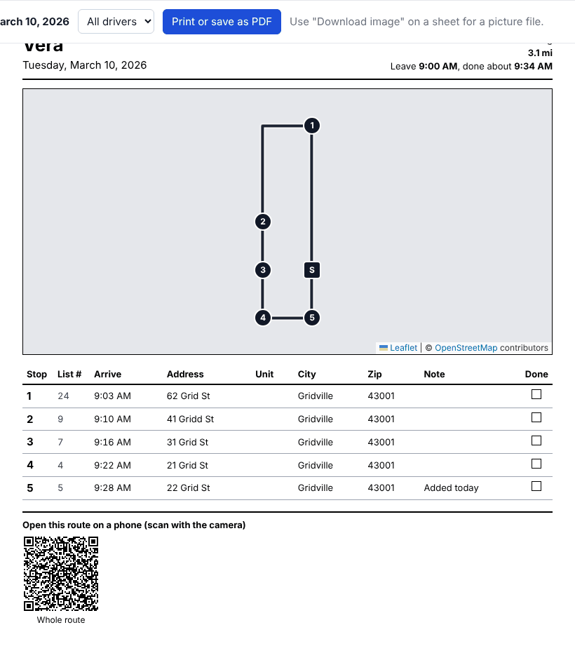

# 6. Export

Both exports are at the top right of the **Routes** section.

## Download CSV

**Download CSV** gives one file for the day, named for the date, that opens in Excel. The rows are in the order you pasted them, so it lines up with your own sheet.

| Column | What it holds |
|---|---|
| List Order | The row's place in the pasted list. |
| Street, Unit, City, State, Zip | The address as it stands in the review table. |
| Extra 1, Extra 2, … | Any extra columns you pasted, unchanged. |
| Driver | Who has the stop. |
| Stop Number | Its place in that driver's route. |
| Estimated Arrival | The estimated time, such as 10:42. |
| Notes | The note for the address. |

## Driver sheets

**Driver sheets** opens a new tab with one sheet per driver.

Each sheet has:

- the driver's name, the date, and their totals with leaving and finishing times
- a map of their route with numbered pins
- the stops in driving order, with stop number, list number, arrival time, address, unit, city, zip, note, and a box to tick when done
- one or more QR codes that open the route in Google Maps on a phone

At the top of the tab:

- choose **All drivers** or one driver
- **Print or save as PDF** opens your browser's print window. Each driver starts on a new page.
- **Download image** on a sheet saves that sheet as a picture.

### The QR codes

Scanning a code with a phone's camera opens the route in the driver's own Google Maps, ready to navigate.

Google Maps takes at most ten places in one route, so a longer route has several codes. Each one starts where the last ended, and is labeled with the stops it covers. The driver scans the next code when they finish a part.
