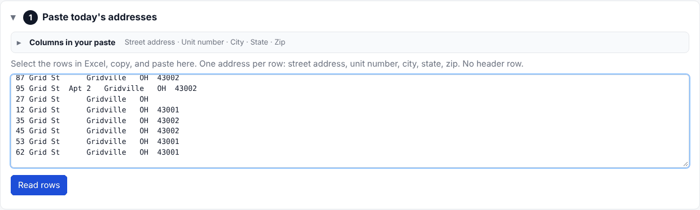

# 1. Paste the addresses

Each day starts on the **Day plan** page with that day's list of addresses.

## Choose the day

The date is at the top of the page. Use the arrows to step a day at a time, type or pick a date in the date box, or press **Today**. Every day has its own list and its own routes, and you can go back to an earlier day to look at it.

A new day starts with the same drivers ticked and the same choice of time or miles as the most recent day.

## Paste the rows

1. In Excel, select the rows for the day and copy them.
2. Click in the box under **Paste today's addresses** and paste.
3. Press **Read rows**.

What the app expects:

- **One address per row.**
- **One part of the address per column:** street address, unit number, city, state, zip.
- **No header row.** A header would be read as an address and marked "Fix this row"; remove it with the ✕ at the end of the row.

Extra columns are fine. They are kept and passed through to the [CSV export](export.md).

The app tidies a few things as it reads:

- A zip code that lost its leading zero in Excel (2134 for 02134) gets it back.
- A state written out in full ("Ohio") becomes its two-letter code.
- An empty unit cell stays empty. It is not filled from the next column.

## If the columns are in a different order

The app works out which column is which from what is in them. To see or change its guess, open **Columns in your paste** just above the paste box. Each column shows a sample value and a dropdown: *Street address*, *Unit number*, *City*, *State*, *Zip*, or *Other (keep as is)*.

Change a dropdown and every pasted row is read again with the new layout. The layout is remembered for the next paste with the same number of columns.

## Paste again

Once a day has rows, the paste box folds away. Press **Paste again** to bring it back, then choose:

- **Replace the list** to start the day over with the new rows. This also clears the day's routes.
- **Add to the list** to put the new rows after the ones already there.

Next: [review the table](review.md).
