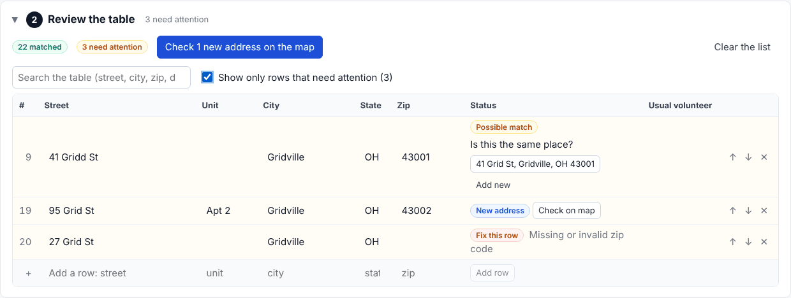
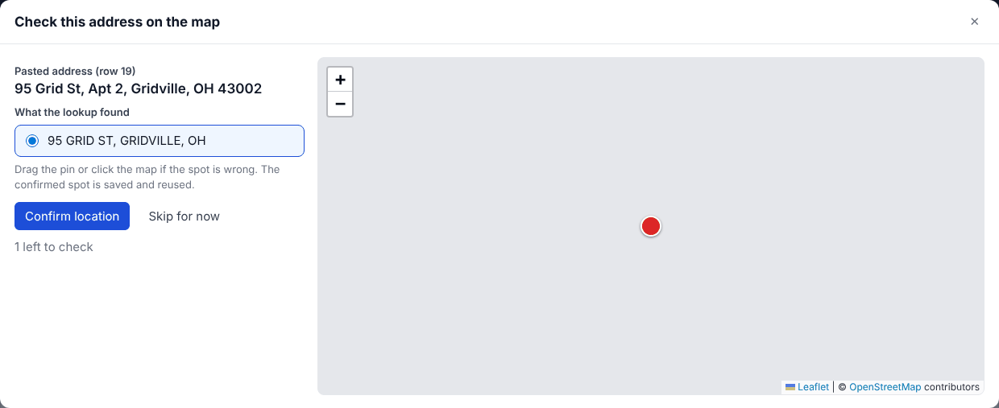
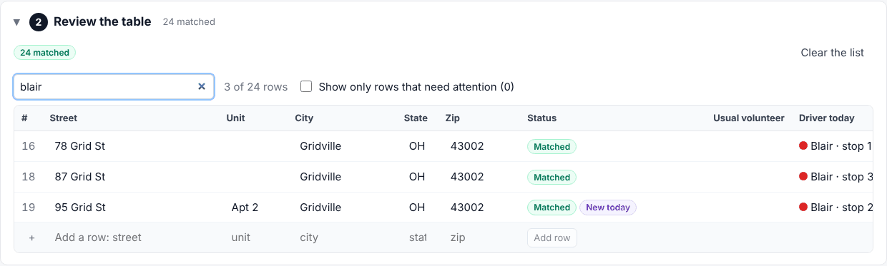

# 2. Review the table

After a paste, the rows appear in a table under **Review the table**. Each row is matched against the addresses the app already knows. Routes can only be built once every row is *Matched*.

## What each status means

| Status | Meaning | What to do |
|---|---|---|
| **Matched** | The street, unit and zip are the same as a known address, allowing for capitals, punctuation and short forms such as St and Street, or Apt and #. | Nothing. |
| **Possible match** | The row is close to one or more known addresses in the same zip, with the same unit. | Click the known address that is the same place, or **Add new** if it is a different place. |
| **New address** | Nothing known resembles it. | Press **Check on map**. See below. |
| **Fix this row** | The street is missing, the zip is missing or not a zip code, or the state is not a US state. | Correct the row in the table. |

Other labels you may see:

- **New today** beside *Matched*: the address was confirmed for the first time today.
- **Same as row 4**: the same address appears twice in today's list. Both rows stay; remove one if it is a mistake.

When you confirm a possible match, the spelling is remembered, so the same spelling matches by itself next time.

## Correcting a row

Every cell can be edited. Click in it, type, and press Enter or click elsewhere. The row is checked again straight away.

At the end of each row, ↑ and ↓ move it up or down the list and ✕ removes it. Removing a row happens at once, with no confirmation.

To add a row by hand, fill in the last line of the table and press **Add row**.

## Checking a new address on the map

A new address has to be placed on the map once. After that it is known, and is not asked about again.

Press **Check on map** on a row, or **Check N new addresses on the map** above the table to go through all of them one after another.

- The left side shows the pasted address and what the address lookup found. If it found several places, pick the right one.
- The pin on the map shows where that is. **If the pin is in the wrong spot, drag it, or click the right spot on the map.**
- Press **Confirm location** to save the address with that location.
- **Skip for now** leaves the address for later and moves to the next one.

Things the dialog may tell you:

- **Low confidence**: the lookup was not sure, for example it found the street but not the building, or found it in a different zip code. Check the pin with extra care.
- **Outside the loaded map region**: the place found is not on your map, so it cannot be routed. Move the pin to the right place, or correct the address.
- **This lands on an address you already have**: the pin is on top of a known address with the same unit. If it is the same place written differently, press **It's the same place**.
- **Same building as … (already confirmed)**: this is a new unit in a building you have already placed. Its confirmed pin is offered first.

If nothing was found at all, close the dialog and correct the spelling in the table, or click the map to place the pin yourself.

## Finding rows

- **Search the table** filters by street, city, zip or driver, and forgives small typos.
- **Show only rows that need attention** hides the matched rows.

Once routes have been built, the table gains a **Driver today** column showing who has each row and its stop number. Searching for a driver's name then lists that driver's stops.

## Unit numbers

The unit is part of what makes an address. Apt 1 and Apt 2 at the same street number are two known addresses, two stops, and can have different usual volunteers and notes. They share one pin on the map.

## Starting over

**Clear the list** removes every row for the day, and the day's routes with them.

Next: [drivers and options](drivers-options.md).
