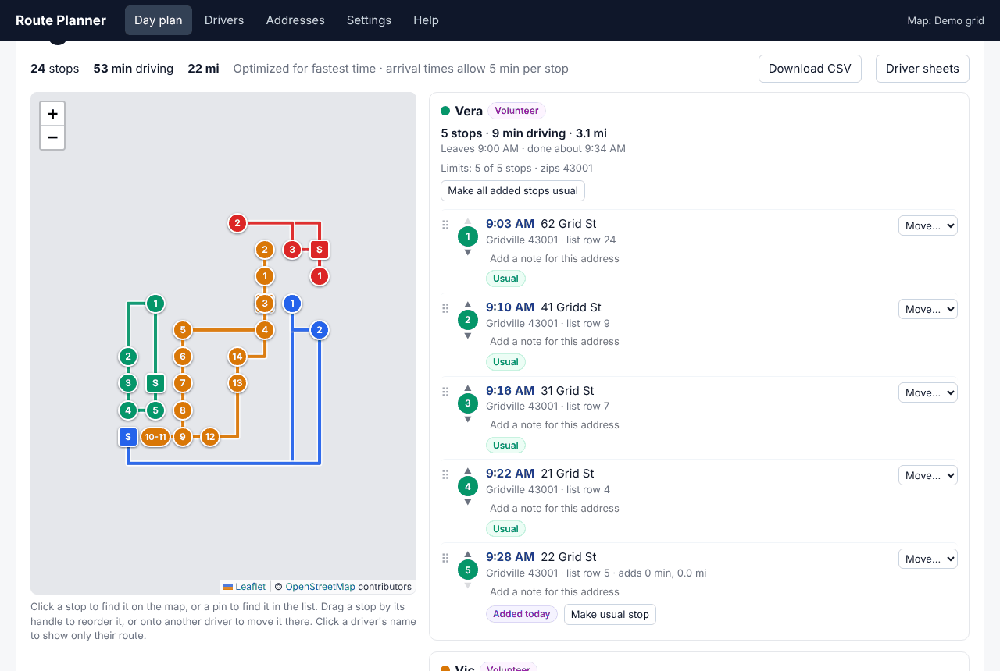
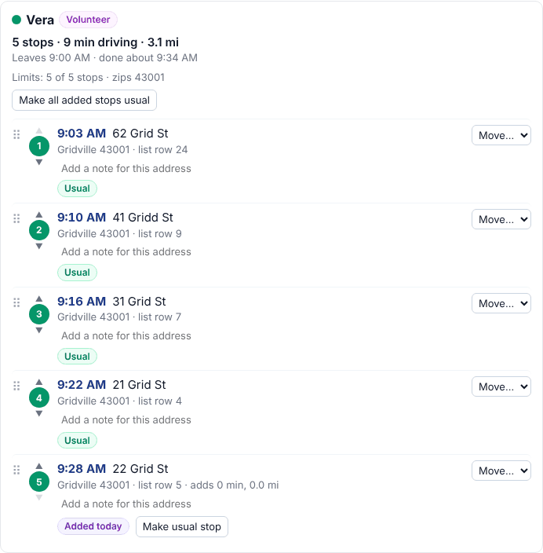

# 4. Building routes

When you press **Build routes**, the app hands the stops out and puts each driver's stops in order. The result appears under **Routes**.

## Totals

The line at the top gives the number of stops, the total driving time and the total distance for the day, and says whether the routes were optimized for time or miles. **Download CSV** and **Driver sheets** are on the right; see [Exporting](export.md).

Below it you may see:

- **A driver was left out** because they have no start and end location.
- **Stops that are not on any route**, each with the reason. This happens when no staff driver is working and the volunteers cannot take everything within their limits.

## Map

Each driver has a color. On the map:

- A line shows the roads the driver follows.
- **S** marks where a driver starts, and **E** where they end if that is somewhere else.
- A numbered pin is a stop, numbered in the order it is driven.
- A pin such as **10-11** is several stops at the same spot, for example two units in one building.

Click a **pin** to jump to that stop in the lists. Click a **stop** in a list to highlight its pin and bring the map to it. Click a **driver's name** to show only their route, and **Show all routes** to bring the others back.

On a wide screen the map stays in place beside the lists as you scroll. On a narrow one it sits above them.

## Driver lists

The heading of each list shows:

- the driver's name, **Staff** or **Volunteer**, and any of *Locked*, *Avoids highways* and *Arranged by hand*
- the number of stops, the driving time and the distance
- when they leave and about when they finish
- for a volunteer with limits, how much of each limit is used, and a red **Over limit** line if one is exceeded

Each stop shows its stop number, estimated arrival time and address, then the city, zip and its row in the pasted list. Under that is a box for a [note](adjust.md#notes), and one of these labels:

| Label | Meaning |
|---|---|
| **Usual** | One of this volunteer's usual stops. |
| **Added today** | An extra stop given to this volunteer for today only. It also shows how much driving it adds. |
| **Covering for Sam** | Sam's usual stop, given to this driver because Sam is off today. |
| **Over Sam's limit** | Sam's usual stop, moved here because it did not fit within Sam's limits today. |
| **Moved here by you** | You moved this stop to this driver. |
| **New address** | An address confirmed for the first time today that landed on a volunteer. |

A stop on a staff driver's list has no label unless it is *Covering for* someone, *Over* someone's limit, or *Moved here by you*.

## Arrival times

The time beside each stop is an estimate: the time the driver leaves, plus the driving so far, plus a set number of minutes at each earlier stop. The number of minutes is in [Settings](../reference/settings.md#planning) and is 5 unless you change it.

The estimates do not affect who gets which stop.

## Out-of-date routes

If you change the list, the drivers, or a setting that affects planning after the routes were built, a yellow line says **Something changed since these routes were built**. Press **Rebuild routes** to bring them up to date.

Next: [adjust the routes](adjust.md).
