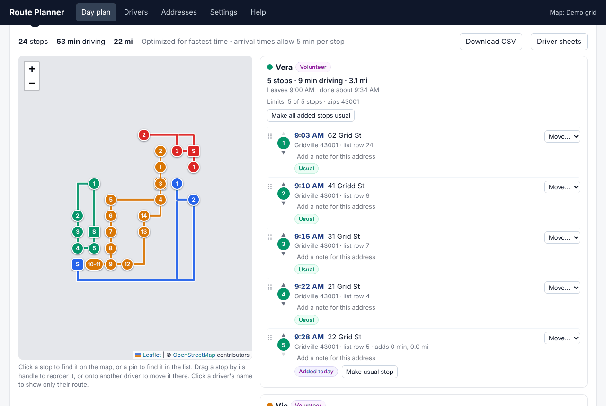

# Route Planner

Route Planner turns a day's list of addresses into a route for each driver.

You paste the addresses from Excel. The app matches them to addresses it already knows, asks you to confirm any new ones on a map, hands the stops out to the drivers working that day (volunteers first, up to their limits, then staff), and puts each driver's stops in the best order. You can then adjust the routes by hand and print a sheet for each driver.

It is an internal tool for one dispatcher. It has no login and is meant to run on your own computer or your own network.

## A day at a glance

1. [Paste](daily/paste.md) the day's rows from Excel.
2. [Review the table](daily/review.md) and check any new addresses on the map.
3. Choose the day's [drivers and options](daily/drivers-options.md).
4. [Build the routes](daily/routes.md) and read them.
5. [Adjust](daily/adjust.md): move stops, reorder them, add notes.
6. [Export](daily/export.md) the CSV or print the driver sheets.

## Where to start

- **Setting it up for the first time?** Start with [Run it on your computer](install/local.md) (no Docker needed) or [Run it with Docker](install/docker.md), then [First-time setup](install/first-time.md).
- **Using it day to day?** Follow [A day's routes](daily/paste.md) from step 1.
- **Wondering why a stop went to a certain driver?** See [How stops are handed out](reference/assignment.md).
- **Something not working?** See [Troubleshooting](reference/troubleshooting.md).

!!! note "About the screenshots"
    The screenshots use a made-up town on a square street grid, with addresses such as "12 Grid St", and no map background. Your own map will show real streets.
