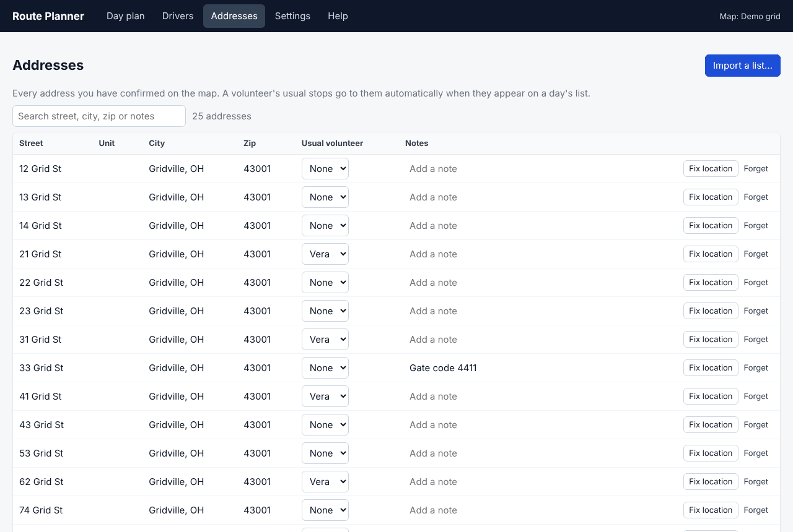
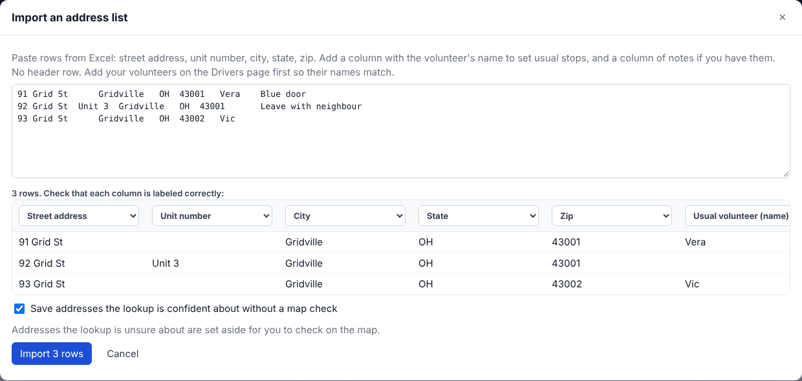

# Addresses and import

The **Addresses** page lists every address the app knows: each one you have confirmed on the map or imported.

## Managing addresses

- **Search** by street, city, zip or note.
- **Usual volunteer.** Choose the volunteer an address usually goes to, or *None*. A locked volunteer cannot be chosen, and an address belonging to a locked volunteer cannot be changed until the lock is turned off.
- **Notes.** Type a note and press Enter. The note follows the address onto every day's routes, the driver sheet and the CSV.
- **Fix location.** Opens the map so you can move the address's pin.
- **Forget.** Removes the address. The next time it is pasted it counts as a new address and is checked on the map again.

To see only one volunteer's usual stops, click the number in the *Usual stops* column on the Drivers page.

## Importing a list

Importing loads an existing list of addresses in one go, with each address's usual volunteer and note.

1. Add your volunteers on the **Drivers** page first, so their names can be matched.
2. On the **Addresses** page press **Import a list…**.
3. Paste the rows from Excel: street address, unit number, city, state, zip. Add a column with the volunteer's name to set usual stops, and a column of notes if you have them. No header row.
4. Press **Read rows**. The app shows the first few rows with a dropdown over each column. Check each is labeled correctly: *Street address*, *Unit number*, *City*, *State*, *Zip*, *Usual volunteer (name)*, *Notes*, or *Ignore*.
5. Press **Import**.

### High-confidence addresses

With **Save addresses the lookup is confident about without a map check** ticked, an address is saved straight away when the lookup finds the building itself, in the right zip code, inside your map. A new unit in a building already known is placed at that building.

Everything else is **set aside for a map check**: addresses the lookup was unsure about, could not find, or found outside the map. Untick the box to set every address aside.

### After the import

The summary shows how many addresses were saved, how many were already known and updated, and how many were set aside. Rows with a problem are listed, for example a row with no zip code, or a volunteer name that matches no volunteer.

Addresses set aside appear at the top of the Addresses page under **imported addresses still need a map check**. For each one:

- **Check on map** opens the map. Press **Find** to look the address up, adjust the pin, and press **Confirm location**.
- **Drop** discards it.

You can also leave them. An address set aside keeps its volunteer and note, and is asked about the first time it appears on a day's list.

### Importing again

Importing an address that is already known updates its usual volunteer and note. It does not create a second copy.

A map must be loaded for addresses to be saved without a map check. Without one, every address is set aside.
