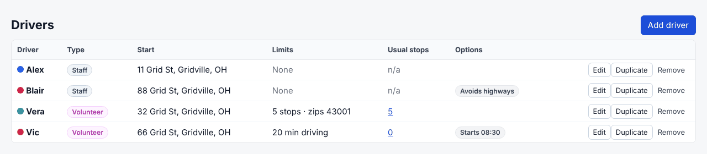
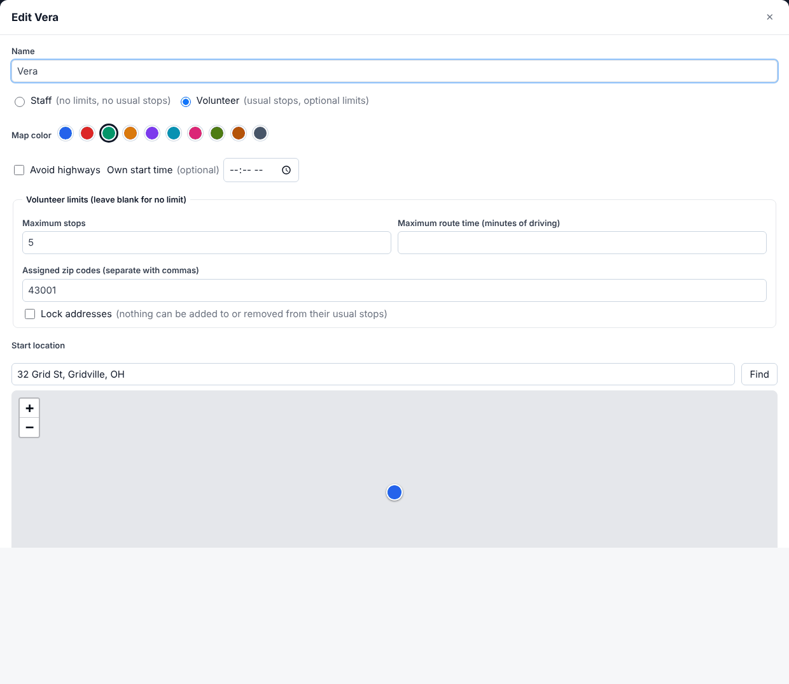

# Drivers

The **Drivers** page lists everyone who can be given stops. Add a driver with **Add driver**; change one with **Edit**; **Duplicate** starts a new driver with the same settings; **Remove** deletes one.

## Staff and volunteers

Every driver is one or the other, and the two are treated differently when stops are handed out.

| | Staff | Volunteer |
|---|---|---|
| Usual stops | None | Yes |
| Limits | None | Optional: maximum stops, maximum driving time, zip codes |
| Lock | Not available | Optional |
| Avoid highways | Yes | Yes |
| Own start and end locations | Yes | Yes |
| Own start time | Yes | Yes |

Volunteers are given stops first, up to their limits. Staff take whatever is left. See [How stops are handed out](assignment.md).

If you change a volunteer to staff, their usual stops are cleared.

## The driver form

**Name** and **Staff or Volunteer**.

**Map color** is the color of the driver's line and pins on the map.

**Avoid highways.** The driver is routed along other roads where there is a reasonable alternative. It is a strong preference, not a ban: a highway is still used where there is no sensible way around it.

**Own start time.** Optional. If set, this driver's arrival times are counted from it. Otherwise the day's *Drivers leave at* time is used.

**Start location.** Type the address and press **Find**, then drag the pin or click the map if it is not quite right. Every route starts here. The location must be inside the loaded map.

**Ends the day at the same place.** Untick it to set a different end location. Every route finishes there, so it affects which stops suit the driver.

A driver with no start location is left out when routes are built, and is flagged on the Day plan page.

## Volunteer limits

All three are optional. Leave a box blank for no limit.

| Limit | Effect |
|---|---|
| **Maximum stops** | The volunteer is not given more stops than this. The one exception is a stop you move onto them by hand. |
| **Maximum route time** | Minutes of driving, from their start, through their stops, to their end. Time spent at stops is not counted. |
| **Assigned zip codes** | Extra stops are only taken from these zip codes. Their usual stops stay theirs whatever the zip, though the route is flagged if one falls outside. |

Each day a volunteer with limits is filled as full as the limits allow.

A volunteer with **no limits at all** is treated like staff when the leftover stops are shared out: they keep their usual stops, then take a share of the rest rather than being filled first.

## Lock

**Lock addresses** freezes a volunteer's set of stops:

- they drive exactly their usual stops that are on the day's list
- they are given no extra stops
- no stop can be moved onto them, and none of their usual stops can be moved away
- their usual stops cannot be changed on the Addresses page

The order of their route can still be changed. If a locked volunteer is off for the day, their stops are covered by others for that day and remain theirs.

This holds even when the volunteer could take more within their limits, and even for stops moved by hand before the lock was turned on. While the lock is on, a stop that had been moved onto the volunteer goes to another driver, and a usual stop that had been moved away comes back. A line above the routes says how many moves were not followed. Turn the lock off and rebuild, and those moves apply again.

## Usual stops

The **Usual stops** column shows how many addresses usually go to each volunteer. Click the number to see them on the Addresses page.

An address becomes a volunteer's usual stop when you press **Make usual stop** on a route, choose the volunteer on the Addresses page, or name the volunteer in an import.

## Removing a driver

Removing a volunteer leaves their addresses in place with no usual volunteer. Removing any driver takes them out of today's and future days' lists of who is working.
