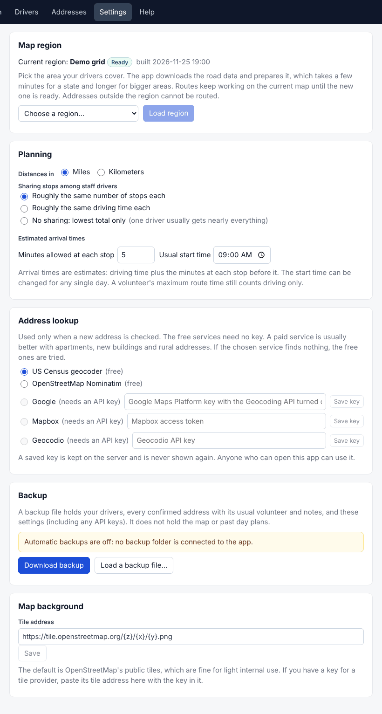

# Settings

Most choices on the **Settings** page are saved as soon as you make them. The map region, API keys and the map background have their own button.

## Map region

The map is the road data the app uses to work out travel times and draw routes. It holds one region at a time.

- **Choose a region** lists each US state. The data comes from Geofabrik's OpenStreetMap extracts.
- **Other: paste a link to a map file** takes a link to any OpenStreetMap `.osm.pbf` extract, for an area smaller or larger than a state. Give it a name of your own.
- **Load region** downloads the data and prepares it. A state takes a few minutes and a few gigabytes of memory; larger areas take longer and need more.

While a new region is being prepared, routes carry on using the current one. If preparing it fails, the reason is shown and the current map stays.

Changing the region does not remove any known addresses. An address outside the new region cannot be routed until a region that covers it is loaded.

## Planning

**Distances in** miles or kilometers.

**Sharing stops among staff drivers** decides how the stops left over by the volunteers are split:

- *Roughly the same number of stops each* (the default)
- *Roughly the same driving time each*
- *No sharing: lowest total only*, which usually gives one driver nearly everything

See [Stop assignment](assignment.md#pass-2-staff).

**Minutes allowed at each stop** is used for estimated arrival times only. The default is 5.

**Usual start time** is the *Drivers leave at* time a new day starts with. You can change it for any single day on the Day plan page.

## Address lookup

The lookup turns a new address into a place on the map. It is used only when a new address is checked or imported; known addresses are never looked up again.

| Service | Cost | Notes |
|---|---|---|
| **US Census geocoder** | Free, no key | The default. US street addresses only. |
| **OpenStreetMap Nominatim** | Free, no key | The public service allows one lookup a second. |
| **Google**, **Mapbox**, **Geocodio** | Paid, needs a key | Usually better with apartments, new buildings and rural addresses. |

To use a paid service, paste its key in the box beside it, press **Save key**, then select the service. A saved key is kept on the computer running the app and is never shown again. **Remove** deletes it.

If the chosen service finds nothing, the free ones are tried.

!!! note
    The three paid lookups have not yet been tried against the live services.

## Backup

See [Backup and restore](backup.md).

## Map background

The **tile address** is where the map's background pictures come from. The default is OpenStreetMap's public tiles, which are fine for light use by one office. If you have an account with a tile provider, paste its tile address here, including its key.

The background needs an internet connection. Without one the map is blank, but pins and routes are still drawn.
